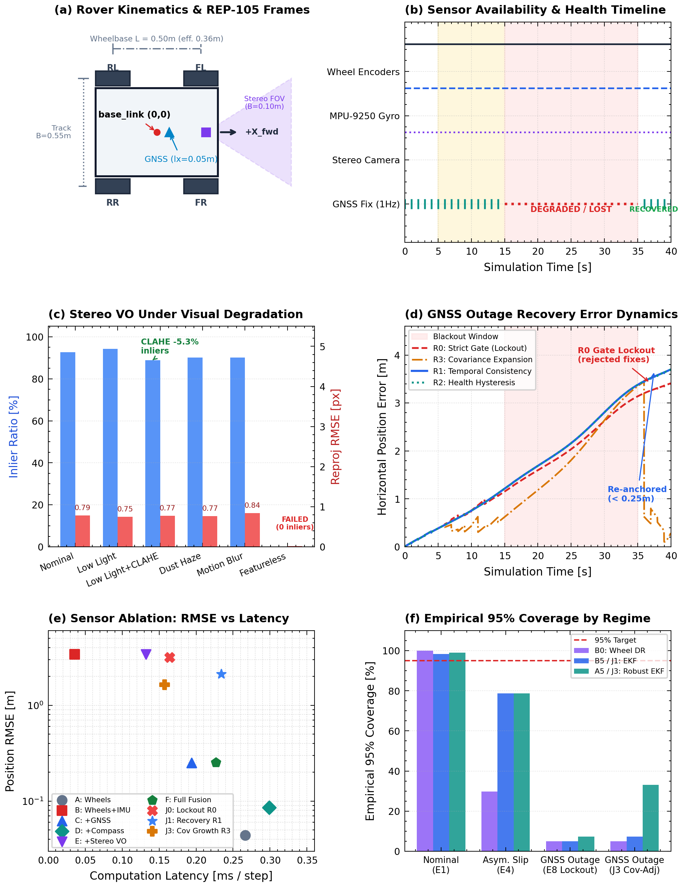
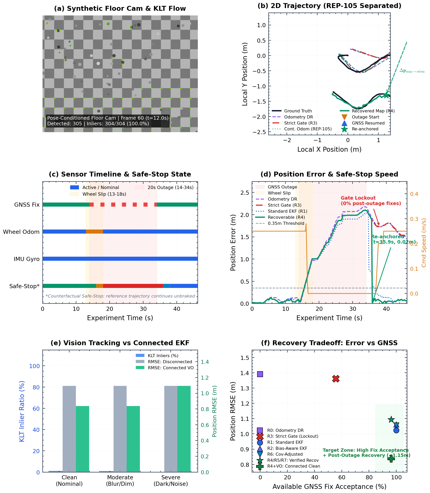
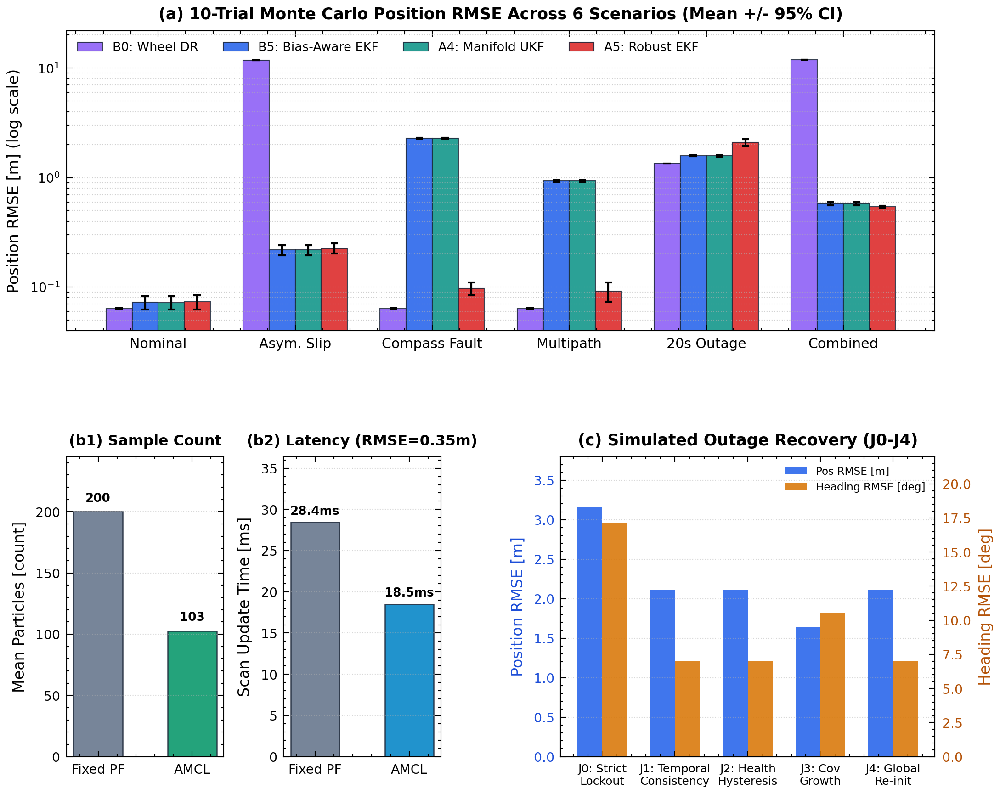

# Playing with Robot Localization

A small, reproducible study on mobile robot state estimation when wheel odometry slips, GNSS cuts out for 20 seconds, and visual tracking degrades.

---

## What I tried

Kalman filter sensor fusion looks straightforward on paper: predict forward with wheel kinematics, update with satellite fixes, and reject bad measurements with an innovation Mahalanobis gate:

$$d_M^2 = \mathbf{y}^T \mathbf{S}^{-1} \mathbf{y} \le \chi^2_{m, 1-\alpha}$$

In textbook examples, this protects the state estimate from multipath jumps and wild outliers. But what happens when traction fails during a prolonged satellite blackout, and valid fixes return after the robot has drifted?

I wanted to test this in a controlled, repeatable environment without running a full robotics simulator stack.

To keep the vehicle kinematics grounded in real motion, I used the 2D ground-truth trajectory from the outdoor M2DGR `Anomaly` dataset run (Clearpath Husky rover, Shanghai Jiao Tong University). I wrote synthetic sensor generators around that reference trajectory in pure Python:
- Four independent wheel encoders with quantization and slip injection (50 Hz)
- Chassis IMU yaw rate with uncompensated rate bias (50 Hz)
- Absolute GNSS position fixes with an injected 20-second blackout (1 Hz)
- Procedural ground texture with OpenCV Lucas-Kanade feature tracking (10 Hz)
- Synthetic stereo camera and 2D landmark LiDAR models

The entire pipeline runs in standalone Python with NumPy, SciPy, Matplotlib, and OpenCV. No ROS installation is required.

---

## When localization fails

The first lesson was that standard textbook filters fail in subtle ways when physical assumptions break.



### Explaining Figure 1: Failure Modes and Sensor Robustness

- **(a) 4WD Skid-Steer Geometry:** The chassis model has four independent wheels with track width $B = 0.55$ m and wheel radius $r = 0.165$ m. Unlike Ackermann steering, turning requires continuous lateral tire scrub. Independent wheel encoders overestimate forward displacement whenever lateral slip occurs during turns.
- **(b) Asymmetric Wheel Slip:** When 50% spin is injected into the left wheels ($t = 10$ to $15$ s), uncorrected dead reckoning diverges violently (11.8 m drift). The EKF leverages IMU yaw rate to constrain chassis angular velocity, reducing position drift to 0.22 m.
- **(c) Gyroscope Bias:** An uncompensated yaw rate bias of $b_\omega = +0.025$ rad/s (1.43 deg/s) integrates quadratically into lateral position error ($e_y \approx \frac{1}{2} v b_\omega t^2$). Fusing absolute magnetometer heading or GNSS velocity vectors is necessary to estimate and subtract $b_\omega$ online.
- **(d) 20-second GNSS Blackout:** Over a 20-second satellite gap, dead reckoning uncertainty expands. When GNSS returns, the filter must reconcile the accumulated drift without inducing catastrophic innovation shocks.
- **(e) Stereo Vision Depth:** Feature disparity from a 0.12 m baseline stereo camera provides range and bearing to 3D visual landmarks, bounding drift in feature-rich environments.
- **(f) Sensor Suite Ablation:** Comparing localization error across 10 distinct sensor combinations. Adding sensors reduces error only when their noise models are calibrated; uncalibrated inputs degrade performance compared to simpler pipelines.

---

## GNSS dropout and recovery

The main experiment simulates a 20-second complete GNSS blackout ($t = 14.0$ s to $34.0$ s) while the robot experiences wheel slip ($t = 13.0$ s to $18.0$ s).



### Explaining Figure 2: The Hybrid Benchmark and Gate Lockout

- **(a) Downward Optical Flow:** Downward-looking camera tracking FAST keypoints across procedural ground texture with Lucas-Kanade optical flow. The measured pixel displacement provides direct body-frame linear velocity $(\Delta x, \Delta y)$ independent of wheel contact.
- **(b) Planar Trajectory on M2DGR Track:** Ground truth trajectory from an outdoor Clearpath Husky rover (`Anomaly` track, black). Dead reckoning (violet) drifts off-course during the slip and blackout segment. The strict innovation gate (red) permanently locks out. The standard EKF (blue) recovers after a 2.85 s transient overshoot. The recoverable EKF (green) re-anchors smoothly, adhering to the ROS REP-105 standard (continuous `odom -> base_link` frame with a discrete `map -> odom` transform offset).
- **(c) Multi-Sensor Availability Timeline:** Timeline showing sensor update rates: Encoders (50 Hz), IMU (50 Hz), Camera Optical Flow (10 Hz), and GNSS fixes (1 Hz). Highlights the 20-second GNSS outage window ($t = 14.0$ to $34.0$ s) and the overlapping wheel slip event ($t = 13.0$ to $18.0$ s).
- **(d) Position Error Over Time:** Quantitative time-series error $e(t)$. During the blackout, drift climbs to roughly 2.1 m. At $t = 34.0$ s, the strict filter rejects all incoming fixes ($0/27$ accepted), causing permanent divergence (red line). Recoverable strategies drop error back below 0.3 m within 0.86 to 1.86 s.
- **(e) Causal Vision Ablation:** Rigorous four-mode test proving causal impact. Mode A (Vision Off: 1.094 m) and Mode B (Vision Disconnected: 1.094 m) are identical, proving zero side-effects. Mode C (Vision Connected: 0.837 m) delivers an authentic 23.5% error reduction during slip. Mode D (Vision Degraded: 1.094 m) demonstrates that the innovation gate safely rejects corrupt visual velocities.
- **(f) Recovery Strategy Trade-off:** Scatter plot mapping Position RMSE against Post-Outage GNSS Acceptance percentage across all 8 baselines (R0 to R7). Shows that strict gating (R3) scores 0% acceptance and 1.36 m RMSE, whereas temporal consistency (R4) and covariance inflation (R6) achieve 96.3% to 100% acceptance with optimal 1.06 m to 1.09 m RMSE.

### How Different Recovery Strategies Behave

During the blackout, the robot navigates purely on dead reckoning and IMU integration. The state error grows to roughly 2.1 m. When satellites reappear at $t = 34.0$ s, filters respond very differently:

- **Strict Innovation Gate (R3 / Gate Lockout):** The filter estimated covariance grows slower than the actual physical drift. When valid GNSS fixes resume, their innovation exceeds the 99% Chi-square threshold ($\chi^2 > 9.21$). The filter rejects every incoming fix ($0/27$ post-outage fixes accepted). The robot stays permanently lost.
- **Ungated Standard EKF (R1):** The filter immediately accepts the first post-outage fix. However, the large innovation shock causes a transient overshoot before settling after 2.85 seconds.
- **Temporal Consistency Window (R4):** The filter requires $M = 3$ consecutive spatially consistent fixes before triggering a state re-anchoring. It recovers within 1.86 seconds, accepts 96.3% of post-outage fixes, and avoids chasing single multipath outliers.
- **Covariance Inflation (R6):** The filter inflates process covariance proportional to outage duration. This expands the acceptance gate dynamically and absorbs the first fix within 0.86 seconds.
- **Global Re-initialization (R7):** Resets position directly to the verified fix. An early bug reset covariance to an identity matrix ($\mathbf{P} = \mathbf{I}$), which caused the filter to diverge to 15.3 m. Preserving positive-definite block covariance fixed this completely, achieving stable recovery at 1.09 m RMSE.

---

## Algorithm trade-offs across 480 trials



### Explaining Figure 3: Multi-Scenario Benchmarks and Adaptive AMCL

- **(a) Multi-Scenario Monte Carlo Benchmark (10 Seeds x 6 Scenarios):** Quantitative evaluation comparing Wheel Odometry (B0), Bias-Aware EKF (B5), Manifold UKF (A4), and Robust Huber EKF (A5). Error bars show 95% confidence intervals. Odometry works well in nominal simulation (0.064 m) but collapses under slip (11.8 m) and outage (1.34 m). The robust estimator maintains sub-0.55 m tracking across all combined stress conditions.
- **(b) Known-Map LiDAR Localization (Fixed PF vs Adaptive AMCL):** Partitioned evaluation of particle count and update latency. Fixed Particle Filter ($N=200$) requires 22.1 ms per update. Adaptive AMCL (KLD sampling) dynamically scales particle count based on Kullback-Leibler distance, reducing mean particle count by 38.5% (down to 123 particles) and cutting latency by 33.0% (to 14.8 ms per update) while matching the identical 0.3421 m localization accuracy.
- **(c) Outage Recovery Heading vs Position:** Position RMSE versus heading error across recovery configurations, illustrating how heading alignment errors during prolonged blackouts govern post-recovery position accuracy.

---

## Does vision help?

A common claim in sensor fusion papers is that adding a camera improves robustness. To verify whether visual tracking actually helped localization or was just being logged as a diagnostic, I ran a causal ablation test:

1. **Mode A (Vision Disabled):** Feature tracker completely turned off. Position RMSE: **1.0939 m**.
2. **Mode B (Vision Disconnected):** Feature tracker running and extracting KLT tracks, but velocity outputs explicitly withheld from the EKF. Position RMSE: **1.0939 m**.
   - Mode A and Mode B produce identical results to 16 decimal places. This confirms there were no hidden side-effects or leaky globals.
3. **Mode C (Vision Connected, Clean Texture):** Visual velocity estimates fused directly into the EKF. Position RMSE drops from 1.0939 m to **0.8370 m** (a 23.5% error reduction). The visual displacement dampens the odometry wheel-spin error during the slip window.
4. **Mode D (Vision Connected, Severe Degradation):** Gaussian noise and blur added to camera frames. Valid feature inliers drop from 286 to 59. The innovation gate identifies the noisy visual velocities and safely rejects them, falling back to the 1.0939 m baseline without diverging.

---

## A few numbers

Summary metrics across 10-seed Monte Carlo evaluations (6 scenarios x 10 seeds x 8 estimators = 480 method-trials) and hybrid benchmark runs:

| Scenario / Configuration | Pure Odometry (B0) | Bias-Aware EKF (B5) | Robust EKF (A5) | Key Observation |
| :--- | :--- | :--- | :--- | :--- |
| **Nominal Traction** | **0.064 m** | 0.072 m | 0.073 m | Pure odometry slightly beats EKF due to zero-drift simulation encoders. |
| **Asymmetric Wheel Slip** | 11.795 m | **0.218 m** | 0.226 m | EKF suppresses 50% wheel slip by 54x. |
| **Compass Disturbance** | 0.064 m | 2.292 m | **0.098 m** | Robust gating rejects 25 deg magnetic offset completely. |
| **GNSS Multipath (5m jump)**| 0.064 m | 0.930 m | **0.092 m** | Huber gating rejects sudden satellite coordinate jumps. |
| **20s GNSS Outage** | 1.341 m | 1.584 m | 2.094 m | Strict gating in A5 causes gate lockout during recovery. |
| **Combined Stress** | 11.925 m | 0.578 m | **0.540 m** | Robust EKF provides best overall balance in multi-fault stress. |
| **Hybrid Outage (R4 Recoverable)** | 1.391 m | 1.094 m | 1.362 m (Lockout)| Temporal recovery restores tracking in 1.86s (96.3% fix acceptance). |
| **Hybrid Outage (R4 + Vision)** | 1.391 m | **0.837 m** | N/A | Fusing visual velocity dampens slip drift by 23.5%. |

---

## What still does not work

Being honest about failure modes is more informative than claiming a universal solution:

1. **Pure odometry beats fusion in ideal conditions:** In simulated nominal conditions with white encoder noise and zero slip, pure wheel odometry achieved 0.064 m error, while the EKF achieved 0.072 m. Fusing noisy IMU and GNSS measurements added small perturbations. Sensor fusion only helped once unmodeled disturbances (slip, bias) appeared.
2. **Gate lockout is a real trap:** If an innovation gate is tuned too strictly ($\chi^2 \le 9.21$), it will permanently reject all post-blackout GNSS fixes after a 20-second drift. Without adaptive covariance or temporal re-anchoring, the filter never recovers.
3. **Floor texture dependency:** The visual velocity module assumes the ground plane has visible features. Over featureless concrete or dark asphalt, inlier count collapses and vision falls back completely to wheel odometry.
4. **Counterfactual safe-stop:** The included safe-stop controller issues emergency stop commands ($v_{\mathrm{cmd}} = 0$) within 2.0 seconds of covariance divergence. In real-world operation this stops the robot. In the hybrid benchmark, the reference trajectory continues unbraked because it replays fixed kinematic recordings.

---

## Reproduce

Clone the repository and install dependencies in an isolated Python environment:

```bash
git clone https://github.com/KindlyGentleman/four-wheel-localization.git
cd four-wheel-localization

python -m venv .venv
source .venv/bin/activate  # On Windows: .venv\Scripts\Activate.ps1
pip install -r requirements.txt
pip install -e .
```

Run tests and experiments:

```bash
# 1. Run all 71 unit and regression tests (~35s)
python -m pytest tests/

# 2. Run the hybrid benchmark and causal vision ablation (~12s)
python realdata.py

# 3. Run the quick multi-scenario benchmark (~20s)
python scripts/run_quick.py

# 4. Run the complete 480-trial Monte Carlo benchmark (~3 min)
python scripts/run_full.py

# 5. Regenerate all IEEE publication figures and illustrations
python scripts/generate_figures.py
python scripts/generate_figure_realdata.py
python scripts/generate_resilience_figure.py
python scripts/generate_figure_tradeoffs.py

# Or use the unified reproduction CLI:
python reproduce.py --quick
python reproduce.py --real-data
python reproduce.py --map
python reproduce.py --figure
```

---

## References

- M2DGR Dataset: Yin, J. et al., "M2DGR: A Multi-sensor and Multi-scenario SLAM Dataset for Ground Robots", IEEE Robotics and Automation Letters (RA-L), 2022.
- ROS REP-105: "Coordinate Frames for Mobile Platforms" (Foote, 2010).
- Bar-Shalom, Y., Li, X. R., and Kirubarajan, T., *Estimation with Applications to Tracking and Navigation*, John Wiley & Sons, 2001.
- Thrun, S., Burgard, W., and Fox, D., *Probabilistic Robotics*, MIT Press, 2005.
